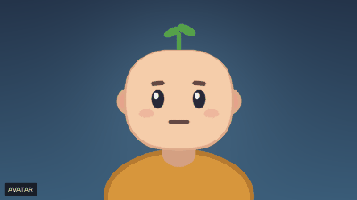
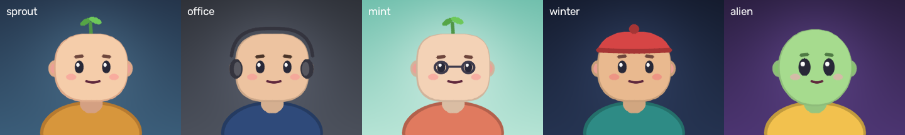

# puppetcam

**An animated avatar for your video calls. Runs 100% locally, on CPU, with no training and no cloud.**

Camera off in a meeting feels like a black hole; camera on isn't always an option.
puppetcam turns your webcam into a cartoon that moves like you: head, eyes, brows,
mouth. Zoom, Meet, Teams and anything else just see a normal webcam.



- **Works everywhere:** shows up as a virtual camera, not a plugin for one app.
- **Light:** a few milliseconds of rendering per frame, no GPU needed.
- **Private:** frames and audio are processed in memory and never leave your machine.
  The only network access is a one-time download of the face model (a few MB).
- **Away mode:** step away and the avatar keeps blinking, breathing and lip-syncing
  to your microphone instead of freezing.
- **Yours:** colors, proportions, accessories and background come from a small theme file.
- **Coming in 0.2.0 — no terminal needed:** an installer for macOS and Windows, and a menu bar / tray icon to turn
  it on and off, change theme and sensitivity, and start it at login.
- **Hackable:** an avatar is one Python class. Add your own as a plugin.

> Status: alpha. Expect rough edges, and please open issues.
>
> **Latest published version: 0.1.1. Version 0.2.0 is still in development.**
> Installers, the menu bar / tray app and saved settings described below are upcoming 0.2.0
> features; they are not included in `pip install puppetcam` yet.

## Quick start

**1. Install a virtual camera backend** (one time):

| OS | What to install |
| --- | --- |
| Windows | [OBS Studio](https://obsproject.com). It ships the "OBS Virtual Camera" driver. Run it once, then quit it. |
| macOS | OBS Studio 30+. Start and stop its Virtual Camera once, allow it (see below), then quit OBS. |
| Linux | Load `v4l2loopback`; install your distro's package only if the module is missing. See [Linux setup and test status](#linux-setup-and-test-status). |

**2. Install puppetcam** (Python 3.11+; on Windows use 3.11 or 3.12, see [platform notes](#platform-notes)):

```bash
pip install puppetcam
puppetcam doctor     # checks camera, face model, microphone and virtual camera
puppetcam            # start with a preview window
```

If you use **pipx**, install with `pipx install puppetcam` instead, then run the same
`puppetcam doctor` and `puppetcam` commands. This installation method was used in the Linux
Mint community report below.

**Coming in 0.2.0:** macOS (Apple Silicon) and Windows installers with the face model included.
They will be available on the [releases page](https://github.com/cesaredavidepace/puppetcam/releases)
once 0.2.0 is published. See [installing the app](#installing-the-app) for the planned setup.

Look at the camera for half a second with a relaxed face while it calibrates. Then in your
meeting app pick **"OBS Virtual Camera"** (or "puppetcam" on Linux) as the camera.

> You don't need OBS open: puppetcam sends its frames into the OBS Virtual Camera itself.
> If you start the Virtual Camera from OBS, you'll see OBS's (empty) scene instead of the avatar.

Preview window keys: `q` quit · `c` recalibrate · `a` toggle away mode · `b` toggle the AVATAR badge.

### The menu bar / tray icon

*Available in the upcoming 0.2.0 release.*

The installed app, or `puppetcam tray`, puts the avatar's face in the macOS menu bar or the
Windows tray (grey when the camera is off). From its menu:

- **Avatar camera** on/off, **Recalibrate**, **Away mode**
- **Theme**, **Sensitivity**, **Camera**, **Show AVATAR badge**
- **Start at login**, **Open settings file**, **Open log** (attach it to bug reports)

If something fails (no virtual camera, webcam busy) the first line of the menu says so;
click it for help. Every change is saved, so a terminal `puppetcam` starts the same way.
On Linux the tray needs `pip install "puppetcam[tray]"` and a desktop with a tray area.

### Settings

*Available in the upcoming 0.2.0 release; `--save` is not supported in 0.1.1.*

Your choices are saved in `settings.toml`, so you don't need flags every time:

| OS | Where |
| --- | --- |
| Windows | `%APPDATA%\puppetcam\settings.toml` |
| macOS | `~/Library/Application Support/puppetcam/settings.toml` |
| Linux | `~/.config/puppetcam/settings.toml` |

```bash
puppetcam --theme winter --sensitivity 2 --save   # try options and keep them
puppetcam settings                                # show the current settings and the file
puppetcam settings --edit                         # open it in a text editor
puppetcam settings --reset                        # back to the defaults
```

Flags always win over the file for that run: with `badge = false` saved,
`puppetcam --badge` shows it once.

### In Google Meet, Microsoft Teams and Zoom

- **Start puppetcam before joining.** If the meeting app or browser was already open and
  doesn't list the camera, restart it.
- **Meet:** Settings → Video → Camera. **Teams:** Settings → Devices → Camera.
  **Zoom:** Settings → Video → Camera.
- **Turn off background blur and virtual backgrounds** in the meeting app: they try to cut a
  person out of the cartoon. Change the background with a [theme](#themes-make-it-yours) instead.
- Your own self-view may show the AVATAR badge mirrored. Others see it the right way round.
- Small expressions too subtle? Try `puppetcam --sensitivity 2` (default 1.5), and press `c`
  to recalibrate with a relaxed face. If the avatar jitters while you're still, go down to 1.2.

### Installing the app

*The installers are planned for 0.2.0 and are not published yet. Use the pip or pipx
instructions above for 0.1.1.*

- On macOS, drag Puppetcam to Applications and open it; it lives in the menu bar.
  On Windows, run the installer; Puppetcam lives in the tray, next to the clock.
  Both installers include the face model, so no model download is needed on first run.
- **macOS:** if macOS says the app "can't be opened" or is from an unidentified developer,
  open **System Settings → Privacy & Security**, scroll down and click **Open Anyway** (needed
  once, until the app is notarized). The first time you turn the camera on, macOS asks for
  camera and microphone access for Puppetcam. Intel Macs: use the pip install.
- **Windows:** the installer needs no admin rights and installs to your user folder. If
  SmartScreen shows "Windows protected your PC", click **More info → Run anyway** (until the
  installer is code-signed). With **Smart App Control** on, Windows blocks unsigned apps entirely:
  use the pip install with Python 3.12 for now.
- Uninstalling: drag Puppetcam to the Trash (macOS), or Settings → Apps (Windows). Your settings
  file stays, delete it by hand if you like.

### Platform notes

**Windows**
- **Use Python 3.11 or 3.12.** Windows 11's Smart App Control blocks the MediaPipe library
  that comes with Python 3.13+ (`WinError 4551`, "An Application Control policy has blocked
  this file"), because it isn't code-signed. On 3.11/3.12 puppetcam installs an older MediaPipe
  that Windows allows. With several Pythons installed: `py -3.12 -m pip install puppetcam`,
  then `py -3.12 -m puppetcam`. `puppetcam doctor` detects the block.
- The camera is opened with DirectShow + MJPG: it starts in well under a second, where
  Media Foundation can take several.
- Older Pythons than 3.11 sleep in ~15 ms steps on Windows, which makes the frame rate uneven.
- While you're away, the tracking thread switches to Windows 11 "efficiency mode" (EcoQoS).

**macOS**
- Allow the virtual camera: on macOS 26 (Tahoe) it's under **System Settings → Privacy &
  Security → Extensions → OBS → Media Extension**; on older versions under Login Items &
  Extensions → Camera Extensions. Then restart OBS once.
- Camera permission is asked for the app you launch from (Terminal, iTerm, VS Code...).
- Use a native arm64 Python on Apple Silicon (not x86 under Rosetta, which is much slower).
- Try `--gpu`: MediaPipe can run on Metal, which is faster than CPU on Apple Silicon.
- App Nap is disabled automatically, so macOS doesn't throttle puppetcam while your meeting app
  is in front.

#### Linux setup and test status

A [community report in #1](https://github.com/cesaredavidepace/puppetcam/issues/1) tested
**puppetcam 0.1.1 on Linux Mint 22.3, Cinnamon / X11, Python 3.12.3**, installed with pipx:

- `puppetcam doctor` passed all checks, including a real webcam and the virtual camera.
- The tester reported working virtual-camera output in **webcamtests.com** through the browser's
  `getUserMedia()` API. Meet, Zoom and Teams were **not tested in this report**.
- Up/down head movement was reported as reversed. Try `puppetcam --invert-pitch`
  (already available in 0.1.1); confirmation from the tester is still pending.
- Qt font warnings appeared in the preview logs, but the application started and ran.

This is a report for one setup and version, not validation of every Linux distro or of 0.2.0.
CI also covers install, tests and rendering on Ubuntu. Reports from other distros, Wayland
sessions and meeting apps are welcome in [#1](https://github.com/cesaredavidepace/puppetcam/issues/1).
Include `puppetcam doctor`, your distro, desktop, X11/Wayland, browser or meeting app and version,
and any problems you noticed.

**Set up the virtual camera:** your system may already provide `v4l2loopback`. The Mint tester
used a preinstalled signed kernel module and did not need `v4l2loopback-dkms`. First try:

```bash
sudo modprobe v4l2loopback devices=1 exclusive_caps=1 card_label="puppetcam"
```

If the module is missing, install the package for your distro and running kernel. On
Debian/Ubuntu-based systems, one option is `sudo apt install v4l2loopback-dkms`; then retry
the `modprobe` command above. Fedora, Arch and other distros have different packaging.

- **Start puppetcam before opening the meeting in the browser.** With `exclusive_caps=1`, Chrome
  only lists the virtual camera once frames are flowing into it.
- `--gpu` works only with MediaPipe wheels built with GPU support; otherwise it falls back to CPU.

## Something doesn't work?

Run `puppetcam doctor` and paste its output into a
[new issue](https://github.com/cesaredavidepace/puppetcam/issues/new/choose). It shows your OS,
Python, camera, microphone and virtual camera status in a few lines.

Using the installed app? Attach the log instead (menu → **Open log**), or run the doctor from it:
`/Applications/Puppetcam.app/Contents/MacOS/puppetcam doctor` on macOS.

## Useful options

In 0.2.0, supported run settings can be saved with `--save` (see [settings](#settings)).

```bash
puppetcam --size 1280x720          # output resolution (default 960x540)
puppetcam --theme office           # pick a theme (see below)
puppetcam --track-fps 15           # track at 15 Hz: about half the CPU, still smooth
puppetcam --gpu                    # try GPU tracking, falls back to CPU if unavailable
puppetcam --no-preview             # headless
puppetcam --no-vcam                # just the preview window, to try it out
puppetcam --invert-yaw             # if left/right head movement is reversed
puppetcam --invert-pitch           # if looking up makes the avatar look down
puppetcam --invert-roll            # if head tilt is reversed
puppetcam --swap-eyes              # if it winks with the wrong eye
puppetcam --sensitivity 2          # exaggerate small movements more (default 1.5, 1 = linear)
puppetcam bench --video 0          # measure tracking and render cost on your machine
puppetcam demo demo.mp4            # render a scripted clip, no webcam needed
```

## Themes: make it yours



```bash
puppetcam themes                                  # list built-in themes
puppetcam --theme winter                          # use one
puppetcam themes --export sprout my-theme.toml    # copy the full template
puppetcam themes --check my-theme.toml            # validate your edits
puppetcam --theme my-theme.toml
```

A theme only needs what it changes. A blue sweater, glasses and your own background:

```toml
name = "Me"

[colors]
sweater = "#3B6FD4"

[accessories]
items = ["glasses"]            # sprout, glasses, beanie, headphones

[background]
image = "my-office.jpg"        # relative to this file; cropped to fill
```

Everything you can set (colors, head roundness and proportions, eye size and spacing, mouth
width, body width, accessories, background) is listed with comments in
[`themes/sprout.toml`](src/puppetcam/themes/sprout.toml). Shades like `skin_shade` are derived
automatically unless you set them. Themes cost nothing at runtime: they're applied once at startup.

## How it works

```
 webcam ──► sensor thread ─────────────────────► render loop (30 fps) ──► virtual camera
            capture 640x480                      mapping + calibration
            MediaPipe Face Landmarker            presence: tracking / hold / away
            (52 blendshapes + head pose)         idle animator + mic level
                                                 One Euro smoothing
                                                 avatar.render(params)
```

1. **Tracking:** [MediaPipe Face Landmarker](https://ai.google.dev/edge/mediapipe/solutions/vision/face_landmarker)
   gives 52 ARKit-style blendshape scores (jaw open, blink, smile...) and the head rotation.
   Pre-trained and used as-is.
2. **Mapping:** plain arithmetic turns those into 11 normalized parameters (`AvatarParams`),
   relative to your resting face captured at startup.
3. **Presence:** if your face disappears, the avatar holds its pose for a moment, then fades
   into idle animation with mouth driven by microphone loudness.
4. **Smoothing:** a [One Euro filter](https://gery.casiez.net/1euro/) removes jitter without adding lag.
5. **Rendering:** the default avatar is drawn with anti-aliased OpenCV polygons. The 3D effect
   is parallax: features slide, the far eye narrows, ears move the other way, the leaf bounces on a spring.

Performance notes and measurements: [docs/optimization.md](docs/optimization.md).

## Privacy and honesty

- No frames, audio or landmarks are saved or sent anywhere.
- The **AVATAR badge is on by default**. People in a call deserve to know they are looking at
  an avatar. You can hide it, but please tell them.

## Write your own avatar

```python
from puppetcam.avatars import Avatar
from puppetcam.params import AvatarParams

class MyAvatar(Avatar):
    name = "mine"
    def render(self, p: AvatarParams, dt: float):
        ...  # return an HxWx3 uint8 BGR image
```

Register it from your own package, no fork needed:

```toml
[project.entry-points."puppetcam.avatars"]
mine = "my_package.avatar:MyAvatar"
```

Then `puppetcam --avatar mine`. See [CONTRIBUTING.md](CONTRIBUTING.md).

## Roadmap

What's coming next. Priorities follow your feedback: open an
[issue](https://github.com/cesaredavidepace/puppetcam/issues/new/choose) or a
[discussion](https://github.com/cesaredavidepace/puppetcam/discussions) to push for something.

**v0.1 — for people comfortable with a terminal**

- [x] Cartoon avatar as a virtual camera for Meet, Teams, Zoom and any other app
- [x] Away mode, themes, avatar plugins
- [x] `--sensitivity` for small movements, `puppetcam doctor` to check your setup

**v0.2 — in development, not yet released: no terminal needed**

Checked items below are implemented on this branch; release installers are not published yet.

- [x] Settings saved in a file: theme, camera, sensitivity, badge. No more command-line flags
- [x] Menu bar app (macOS) and tray app (Windows): on/off, theme, sensitivity, recalibrate,
      start at login
- [x] One-click installers: an app for macOS and an installer for Windows, with the face
      model included (no download on first run)
- [ ] Code-signed and notarized installers, so macOS and Windows open them without warnings

**v0.3 — make your own character**

- [ ] Draw-your-own avatar from a few PNG layers (head, eyes, mouth shapes), no code needed
- [ ] More themes and avatars from the community

**Later**

- [ ] Own virtual camera, so OBS is no longer required (Windows 11 and macOS)
- [ ] Upper body: shoulders and hands from MediaPipe Pose Landmarker (lite)
- [ ] "Your photo" avatar: animate a single photo by mesh warping, still CPU-only
- [ ] Adaptive tracking rate (slow down when you're still, not only when away)

## License

MIT, see [LICENSE](LICENSE). The face model comes from Google's MediaPipe model storage and is
covered by its own model card and license (see the
[Face Landmarker page](https://ai.google.dev/edge/mediapipe/solutions/vision/face_landmarker#models)).
The pip package downloads it on first run; the installers include it.
